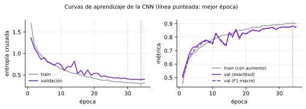

# Fase 4 · Modelado

> Código: `src/training/` (entrenamiento), `src/models/` (CNN, grados, predictor). Resultados crudos: `experiments/results/`.

## 4.1 Formulación común

Todos los modelos resuelven el **mismo** problema: estimar la distribución conjunta
$P(\text{fruta}, \text{calidad} \mid x)$ sobre las 12 clases (6 frutas × buena/mala). De ella
se obtienen, por marginalización, las dos salidas que usa el negocio:

$$P(\text{buena}\mid x)=\sum_{f} P(f,\text{buena}\mid x), \qquad \hat f=\arg\max_f \sum_q P(f,q\mid x).$$

Un modelo conjunto (en lugar de dos separados) aprovecha que lo que significa "mala"
depende de la fruta: un banano con manchas marrones no es lo mismo que una naranja con
moho. Los grados Primera / Segunda / Descarte se derivan de $P(\text{buena}\mid x)$ con la
regla de rechazo de la sección 4.5.

**Protocolo de ajuste.** Para que la comparación sea justa:

- todos usan la misma partición (train 8.078 · val 1.620 · test 1.614), agrupada por ráfaga;
- los modelos clásicos se ajustan con `GridSearchCV` y **validación cruzada de 5 pliegues
  `StratifiedGroupKFold`** sobre train (los grupos son las ráfagas, así ningún pliegue de
  validación ve fotos casi idénticas a las de entrenamiento);
- la métrica de selección es el **F1-macro** de 12 clases, porque las clases están
  desbalanceadas (de 763 a 1.154 capturas por clase; de 541 a 826 en train) y la exactitud premiaría a las
  mayoritarias;
- el desbalance se compensa con pesos por clase $w_k = N/(K\,N_k)$ (`class_weight="balanced"`
  o pesos de muestra en XGBoost, y entropía cruzada ponderada en la CNN);
- **el conjunto de prueba se usa una sola vez**, al final, para reportar.

## 4.2 Modelos de ML clásico (sobre 418 características)

| Modelo | Por qué se eligió | Hiperparámetros explorados | Mejor | F1 CV |
|---|---|---|---|---|
| **Regresión logística** (multinomial, L2) | Línea base lineal e interpretable. Si las características ya separan las clases, un modelo lineal debería bastar | $C \in \{0{,}01;\ 0{,}1;\ 1\}$ | $C=0{,}1$ | 0,791 |
| **SVM con kernel RBF** | Frontera no lineal de margen máximo; funciona bien con ~400 dimensiones y pocos miles de muestras | $C\in\{1, 10, 100\}$, $\gamma\in\{\text{scale}, 10^{-3}\}$ | $C=100,\ \gamma=10^{-3}$ | 0,823 |
| **Random Forest** (400 árboles) | Ensamble por *bagging*: reduce varianza, no requiere escalar y tolera características irrelevantes | `max_features` ∈ {√d, 0,1}, `min_samples_leaf` ∈ {1, 3} | 0,1 · 1 | 0,854 |
| **XGBoost** (400 árboles) | *Boosting* de gradiente: cada árbol corrige el error de los anteriores; suele ser el mejor en datos tabulares | `max_depth` ∈ {4, 6}, `learning_rate` ∈ {0,05; 0,1} | 6 · 0,05 | **0,861** |

Las tablas completas de la búsqueda están en `experiments/results/cv_<modelo>.csv`.

**Formulaciones.**

- *Regresión logística:* $P(y=k\mid x)=\operatorname{softmax}(Wx+b)_k$; se minimiza
  $-\sum_i w_{y_i}\log P(y_i\mid x_i)+\tfrac{1}{2C}\lVert W\rVert^2$. Un $C$ pequeño regulariza más.
- *SVM-RBF:* $\min \tfrac12\lVert w\rVert^2 + C\sum_i \xi_i$ con kernel
  $K(x,x')=\exp(-\gamma\lVert x-x'\rVert^2)$; multiclase uno-contra-uno y probabilidades por
  escalamiento de Platt. $C$ controla cuánto se castigan los errores y $\gamma$ el alcance de
  cada vector de soporte.
- *Random Forest:* promedio de árboles entrenados con muestras *bootstrap* y subconjuntos
  aleatorios de características en cada corte (criterio Gini). Promediar árboles poco
  correlacionados reduce la varianza sin aumentar el sesgo.
- *XGBoost:* modelo aditivo $F_m = F_{m-1} + \eta f_m$, donde cada árbol $f_m$ se ajusta con la
  expansión de segundo orden de la log-pérdida y una penalización
  $\Omega(f)=\gamma T + \tfrac12\lambda\lVert w\rVert^2$ sobre hojas y pesos.

**Observaciones de la búsqueda.**

- En los cuatro modelos las diferencias entre configuraciones son pequeñas (≤ 2 puntos de
  F1 CV) comparadas con la desviación entre pliegues (≈ 3 puntos). El rendimiento lo
  determinan sobre todo las características y la familia de modelo, no el ajuste fino.
- La desviación entre pliegues es alta porque cada pliegue agrupa ráfagas completas: un
  pliegue puede caer con sesiones de fondo o luz muy distintas. Es la estimación honesta;
  sin agrupar, la CV daría cifras infladas por fotos casi duplicadas.
- Tiempo total de búsqueda en CPU (16 hilos): logística 21 s, SVM 257 s, RF 200 s, XGBoost 1.172 s.

## 4.3 CNN desde cero

**Arquitectura** (`src/models/cnn.py`, 113.068 parámetros, entrada 3×96×96):

```
[Conv 5×5, 32]  → BatchNorm → ReLU → MaxPool 2×2   → 32×48×48
[Conv 3×3, 64]  → BatchNorm → ReLU → MaxPool 2×2   → 64×24×24
[Conv 3×3, 128] → BatchNorm → ReLU → MaxPool 2×2   → 128×12×12
Global Average Pooling                              → 128
Dense 128 → ReLU → Dropout(p)                       → 128
Dense 12 (softmax)                                  → 12
```

| Decisión | Justificación |
|---|---|
| 3 bloques convolucionales | Campo receptivo final de ~44 px sobre 96 px: alcanza para ver una mancha o un golpe completo. Con más bloques la red tendría más parámetros que lo que ~8.000 imágenes pueden sostener |
| Primer kernel 5×5 | Más contexto en la primera capa (texturas de cáscara) sin agregar profundidad |
| BatchNorm | Normaliza las activaciones por lote; permite tasas de aprendizaje más altas y estabiliza el entrenamiento |
| Global Average Pooling | Reduce la primera capa densa de ~2,4 M a ~16 K parámetros; principal defensa contra el sobreajuste |
| Dropout | Regularizador: apaga neuronas al azar con probabilidad $p$ |
| 96×96 en lugar de 128×128 | En CPU, 128 px tomaban ~200 s por época; 96 px con formato `channels_last` toman ~70 s, y las manchas siguen siendo visibles |

**Entrenamiento** (`src/training/train_cnn.py`):

- pérdida: entropía cruzada ponderada $L=-\frac1N\sum_i w_{y_i}\log \hat p_{y_i}$;
- optimizador AdamW (decaimiento de pesos $10^{-4}$), tasa con decaimiento coseno
  $\eta_t=\eta_0\cdot\tfrac12(1+\cos(\pi t/T))$, lotes de 64;
- aumento de datos solo en train: recorte aleatorio (escala 0,6–1), volteos, rotación ±25°,
  brillo, contraste y saturación ±20–25 %. El **tono casi no se altera** (±0,02) porque el
  color es la señal de calidad;
- parada temprana: se guarda el modelo con mejor F1-macro de validación y se detiene si
  no mejora en `patience` épocas.

**Búsqueda de hiperparámetros.** Una CNN no se puede ajustar con `GridSearchCV` de 5
pliegues en CPU (cada entrenamiento tarda ~15 min), así que se usa el conjunto de
validación como *hold-out*: una rejilla de 2×2 sobre los dos hiperparámetros que más
influyen, con 12 épocas cada una, y el mejor se reentrena hasta 35 épocas.

| $\eta_0$ | Dropout | F1 train | F1 val | Exactitud calidad val | Tiempo |
|---|---|---|---|---|---|
| $10^{-3}$ | 0,3 | 0,876 | **0,828** | 0,922 | 14,8 min |
| $10^{-3}$ | 0,5 | 0,854 | 0,809 | 0,914 | 14,0 min |
| $3\cdot10^{-3}$ | 0,3 | 0,886 | 0,810 | 0,928 | 14,2 min |
| $3\cdot10^{-3}$ | 0,5 | 0,852 | 0,782 | 0,912 | 14,5 min |

*(12 épocas cada una; el F1 de train se mide sin aumento de datos.)*

- **Dropout 0,3 supera a 0,5** con las dos tasas: con solo 113 K parámetros y aumento de
  datos, la red no tiene capacidad de sobra y más dropout la sub-ajusta (F1 train más bajo).
- **$\eta_0 = 10^{-3}$ supera a $3\cdot10^{-3}$** en validación: con la tasa mayor el F1 de
  train sube más rápido al principio (F1 val 0,57 frente a 0,51 en la época 1), pero termina
  más bajo: con el decaimiento coseno, la tasa menor afina mejor en las últimas épocas.
- En las cuatro corridas el mejor F1 de validación se alcanzó en la **última** época: el
  modelo seguía mejorando. Por eso el modelo final se reentrena con la mejor
  configuración hasta 35 épocas, con parada temprana de paciencia 8.

## 4.4 Alternativas consideradas y descartadas

| Alternativa | Por qué se descartó |
|---|---|
| Transferencia de aprendizaje (ResNet, MobileNet preentrenadas) | El enunciado pide una CNN **desde cero**. Además, sería la línea de trabajo futuro natural (FruitNet reporta >95 % con redes preentrenadas) |
| Usar todas las 19.526 imágenes (con copias aumentadas) | El 39 % son copias de la misma captura; entrenar con ellas sesga hacia las clases con más copias y, si quedan en conjuntos distintos, infla las métricas |
| Dos modelos separados (fruta y calidad) | Pierde la dependencia entre fruta y defecto; el modelo conjunto da ambas respuestas por marginalización |
| Clasificar directamente en 3 grados | El dataset solo tiene etiquetas buena / mala; inventar una etiqueta "Segunda" sería ruido. La regla de rechazo deriva el tercer grado de forma justificada |
| Segmentar la fruta antes de clasificar | La segmentación por distancia de color en Lab (usada para el tamaño) es frágil en fondos de pasto o tierra, presentes en el dataset; sus errores se propagarían al clasificador. Se prefirió que el modelo aprenda a ignorar el fondo y medir cuánto lo usa (Grad-CAM, fase 5) |
| Partición aleatoria simple | Pone fotos de la misma ráfaga (segundos de diferencia, mismo fondo y luz) en train y test; el modelo puede acertar recordando la sesión en vez de la fruta, y las métricas dejan de medir la generalización |

## 4.5 Del modelo al grado comercial

Con $p = P(\text{buena}\mid x)$, se aplica la regla de rechazo de Chow:

$$\text{grado}(x)=\begin{cases}\text{Primera} & p \ge \tau_{\text{alto}}\\ \text{Descarte} & p\le\tau_{\text{bajo}}\\ \text{Segunda} & \text{en otro caso}\end{cases}$$

Los umbrales se ajustan en **validación** para que Primera y Descarte tengan una precisión
de al menos $\pi = 98\,\%$:
$\tau_{\text{alto}}=\min\{\tau: P(\text{buena}\mid p\ge\tau)\ge\pi\}$ y
$\tau_{\text{bajo}}=\max\{\tau: P(\text{mala}\mid p\le\tau)\ge\pi\}$.

Se usa 98 % en validación, aunque el criterio de éxito es 95 % en prueba, porque el umbral
queda justo en el borde donde se cumple la meta y en datos nuevos la precisión baja entre
1 y 3 puntos. Con π = 95 % se observó que Segunda quedaba casi vacía (0–1 % de las
frutas) y que Primera solo alcanzaba ~93 % de frutas buenas en prueba. Los umbrales de
cada modelo quedan en `experiments/results/grading_<modelo>.json` y los usa la app.

## 4.6 Selección del modelo final

El modelo final se elige con **validación**, no con prueba:

| Modelo | F1 val | Exactitud calidad val | Brecha train−val |
|---|---|---|---|
| Regresión logística | 0,842 | 0,935 | 0,144 |
| SVM-RBF | 0,882 | 0,938 | 0,118 |
| Random Forest | 0,869 | 0,949 | 0,131 |
| XGBoost | **0,883** | **0,957** | 0,117 |
| CNN (35 épocas, mejor época 34) | 0,881 | 0,962 | **0,066** |

XGBoost y la CNN quedan prácticamente empatados en validación (0,883 frente a 0,881). Para la aplicación se elige la **CNN** por razones que no se reflejan en esa cifra:

1. sobreajusta mucho menos (brecha de 6,6 puntos frente a 11,7);
2. no depende de características diseñadas a mano y es ~6 veces más rápida de punta a punta (6 ms frente a 37 ms por imagen, fase 5);
3. la fase 5 confirmó que generaliza mejor fuera del dataset y que, según Grad-CAM, mira sobre todo la fruta.

XGBoost se conserva como alternativa seleccionable en la app y como el mejor modelo clásico en la comparación. Los resultados en prueba y el análisis completo están en la [fase 5](05_evaluacion.md).


