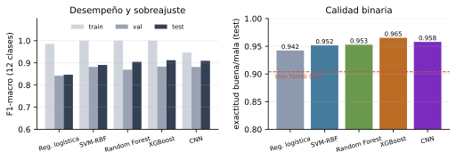
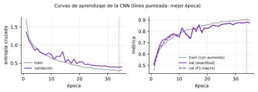
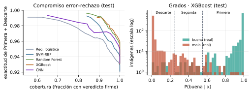
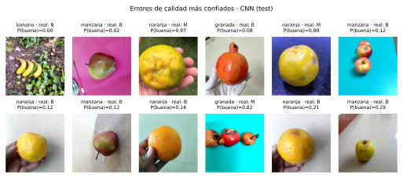
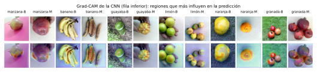
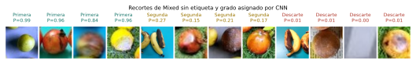
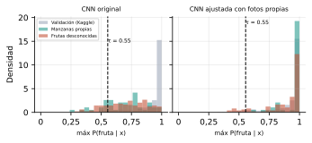

# Fase 5 · Evaluación

> Código: `src/evaluation/` · Resultados: `experiments/results/` (`comparacion_modelos.csv`, `grados_test.csv`, `calidad_por_fruta.csv`, `resumen_evaluacion.json`) · Figuras: `reports/figures/res_*` · Notebook: `notebooks/05_evaluacion.ipynb`
>
> Reproducir: `python -m src.evaluation.evaluate` (unos minutos en CPU).

El conjunto de prueba (1.614 imágenes, ráfagas que ningún modelo vio) se usó **una sola vez**, después de fijar todos los hiperparámetros y umbrales con train y validación.

## 5.1 Comparación de modelos

| Modelo | F1 train | F1 CV | F1 val | **F1 test** (IC 95 %) | Exactitud calidad | AUC calidad | Exactitud fruta | Brecha train−test |
|---|---|---|---|---|---|---|---|---|
| Regresión logística (línea base) | 0,986 | 0,791 | 0,842 | 0,847 [0,828; 0,862] | 0,942 | 0,982 | 0,872 | 0,139 |
| SVM-RBF | 1,000 | 0,823 | 0,882 | 0,891 [0,876; 0,905] | 0,952 | 0,990 | 0,924 | 0,109 |
| Random Forest | 1,000 | 0,854 | 0,869 | 0,905 [0,890; 0,919] | 0,953 | 0,994 | 0,919 | 0,095 |
| **XGBoost** | 1,000 | 0,861 | **0,883** | **0,912** [0,898; 0,925] | **0,965** | **0,995** | **0,936** | 0,088 |
| **CNN** (desde cero) | 0,947 | — | 0,881 | 0,909 [0,895; 0,922] | 0,958 | 0,994 | 0,932 | **0,037** |
| *Control: RF solo con el fondo* | 1,000 | 0,739 | 0,712 | 0,778 [0,759; 0,796] | 0,904 | 0,971 | 0,801 | 0,222 |
| *Control: reg. logística solo con el fondo* | 0,710 | 0,594 | 0,570 | 0,615 [0,591; 0,636] | 0,833 | 0,907 | 0,642 | 0,095 |

F1 = F1-macro de las 12 clases fruta × calidad. IC: intervalo *bootstrap* percentil con 1.000 remuestreos del conjunto de prueba.

**Lectura.**

1. **XGBoost y la CNN quedan empatados.** Sus intervalos de confianza se solapan casi por completo, y la prueba de McNemar sobre las mismas 1.614 imágenes no encuentra diferencia: en calidad, solo la CNN acierta en 34 casos y solo XGBoost en 46 ($p = 0{,}22$); en la tarea conjunta, 73 frente a 80 ($p = 0{,}63$). Con este tamaño de prueba, diferencias de 1–2 puntos no son distinguibles.
2. **Todos superan claramente a la línea base**, y la diferencia entre la regresión logística y los demás sí es significativa (sus intervalos no se tocan con los de RF, XGBoost y la CNN). La no linealidad importa: combinar color y textura de forma no lineal aporta 4–6 puntos de F1.
3. **El F1 de prueba es mayor que el de validación en todos los modelos** (≈ 2–3 puntos). No es fuga (se verificaron cero ráfagas y cero hashes compartidos); con particiones agrupadas cada conjunto recibe sesiones completas, y el de prueba resultó algo más fácil. Por eso la selección se hizo con validación y se reportan intervalos.

## 5.2 Sobreajuste y generalización dentro del dataset

- Los cuatro modelos clásicos llegan a F1 ≈ 1 en train: **memorizan** el conjunto de entrenamiento. Lo que los mantiene útiles es la regularización implícita del ensamble (RF, XGBoost) o del margen (SVM); aun así la brecha con prueba es de 9–14 puntos.
- La **CNN casi no sobreajusta** (brecha de 3,7 puntos). Su F1 de train se mide sin aumento de datos, y la curva de validación sigue de cerca a la de entrenamiento durante las 35 épocas (`res_curvas_cnn.svg`). El aumento de datos, el *dropout*, el decaimiento de pesos y que la red sea pequeña (113 K parámetros) actúan como regularizadores.
- La mejor época fue la 34 de 35: la red **todavía no había convergido**. Con más épocas (o más datos) probablemente superaría a XGBoost; no se hizo por el costo en CPU (≈ 70 s por época).

## 5.3 Grados comerciales y criterios de éxito

Umbrales ajustados en validación con meta π = 98 % (fase 4) y aplicados una sola vez a prueba:

| Modelo | τ_bajo | τ_alto | Cobertura | Primera: % del total · **% buenas** | Segunda: % del total | Descarte: % del total · **% malas** |
|---|---|---|---|---|---|---|
| Regresión logística | 0,038 | 0,739 | 84,5 % | 53,5 % · **96,1 %** | 15,5 % | 31,0 % · **98,4 %** |
| SVM-RBF | 0,146 | 0,662 | 91,3 % | 54,3 % · **97,5 %** | 8,7 % | 37,0 % · **97,7 %** |
| Random Forest | 0,405 | 0,542 | 92,6 % | 52,0 % · **98,9 %** | 7,4 % | 40,6 % · **97,9 %** |
| XGBoost | 0,250 | 0,552 | **95,9 %** | 55,4 % · **97,4 %** | 4,1 % | 40,5 % · **97,9 %** |
| CNN | 0,030 | 0,301 | 94,1 % | 56,9 % · **95,8 %** | 5,9 % | 37,1 % · **99,5 %** |

- **Los cinco modelos cumplen el criterio de ≥ 95 % de precisión** en Primera y en Descarte. Con XGBoost, de cada 100 frutas vendidas como Primera, 2,6 son malas, y de cada 100 descartadas, 2,1 eran buenas.
- La **Segunda** recoge los casos difíciles: en ella solo el 23–51 % de las frutas son buenas, es decir, es justamente donde el modelo duda. Con XGBoost, revisar a mano el 4 % de las frutas elimina la mayoría de los errores.
- La CNN es la más **conservadora con el Descarte** (99,5 % de precisión: casi nunca bota una fruta buena), pero su Primera es la menos pura (95,8 %). Sus probabilidades están más concentradas cerca de 0, lo que se ve en sus umbrales bajos.
- La curva de compromiso error–rechazo muestra el costo de exigir más: para que XGBoost llegue a 99 % de exactitud en sus veredictos firmes, debe enviar a Segunda ≈ 10 % de las frutas.

| Criterio (fase 1) | Meta | XGBoost | CNN | ¿Se cumple? |
|---|---|---|---|---|
| F1-macro (test) | ≥ 0,85 | 0,912 | 0,909 | Sí (también RF y SVM; la línea base queda en 0,847) |
| Precisión de Primera | ≥ 95 % | 97,4 % | 95,8 % | Sí |
| Precisión de Descarte | ≥ 95 % | 97,9 % | 99,5 % | Sí |
| Latencia por imagen en CPU, de punta a punta | < 50 ms | 36,6 ms | **6,2 ms** | Sí |
| Brecha con datos externos | reportarla | 48 % de fruta en *Mixed* | 59 % de fruta en *Mixed* | Reportada (5.6) |

La latencia se midió con la predicción completa de la app (recorte, modelo, grado y segmentación del tamaño), mediana de 60 imágenes de prueba en un portátil con 4 hilos. En XGBoost, 33,5 de los 36,6 ms son la extracción de las 418 características; la CNN solo tarda 2,5 ms en el modelo.

## 5.4 Análisis por fruta y de errores

Exactitud de calidad (buena/mala) por fruta en prueba:

| Fruta | Reg. log. | SVM | RF | XGBoost | CNN |
|---|---|---|---|---|---|
| Banano | 0,963 | 0,952 | 0,952 | 0,963 | 0,959 |
| Granada | 0,895 | 0,919 | 0,958 | 0,954 | 0,947 |
| Guayaba | 0,966 | 0,978 | 0,937 | 0,966 | **0,996** |
| Limón | 0,996 | 0,992 | 0,972 | 0,992 | **1,000** |
| Manzana | 0,895 | 0,910 | 0,928 | 0,931 | **0,957** |
| Naranja | 0,948 | 0,966 | 0,974 | **0,989** | 0,891 |

- Los modelos son **complementarios**: la CNN es la mejor en guayaba, limón y manzana, y XGBoost en naranja, donde la CNN pierde 10 puntos (16 % de las naranjas buenas las clasifica como malas). Un ensamble de ambos es una mejora natural.
- **Matriz de confusión** (`res_confusion_cnn.svg`, `res_confusion_xgb.svg`): los errores de fruta se concentran en pares de color parecido: manzana ↔ granada (13 % de las granadas malas → manzana buena en la CNN), guayaba ↔ manzana y naranja ↔ guayaba.
- **Errores más confiados** (`res_errores_cnn.svg`): varias naranjas y manzanas buenas sostenidas **en la mano o con guantes** reciben P(buena) < 0,15. La red asocia el contexto de la sesión (manos, fondos) con la calidad, otra cara del sesgo de fondo. También aparecen errores de etiqueta en el dataset: en `res_errores_xgb.svg`, una foto etiquetada como «limón malo» contiene guayabas.

## 5.5 ¿Mira la fruta o el fondo? Sesgo de fondo y Grad-CAM

**Control de solo fondo.** Un Random Forest entrenado únicamente con el color de un anillo de 16 px del borde de la imagen (donde casi siempre hay fondo) acierta la calidad en el **90,4 %** de las imágenes de prueba (85,4 % en validación). El fondo por sí solo predice la etiqueta. La imagen completa aporta solo 5–6 puntos sobre ese piso, que son lo que el modelo aprende realmente de la fruta.

**Grad-CAM de la CNN.** Se calculó qué fracción de la activación de Grad-CAM cae en ese mismo anillo, que ocupa el 43,75 % del área:

| Métrica (1.614 imágenes de prueba) | Valor |
|---|---|
| Fracción del área en el anillo del borde | 0,438 |
| Fracción media de la energía de Grad-CAM en el borde | **0,259** |
| Mediana | 0,285 |
| Imágenes con más energía en el borde que su área | **5,1 %** |

La CNN concentra su atención en el centro, donde está la fruta: pone en el borde 40 % menos energía que si mirara al azar, y solo en 1 de cada 20 imágenes el borde pesa más que su área. Los mapas (`res_gradcam.svg`) se ubican sobre las manchas del banano, la zona podrida de la guayaba y la textura de la naranja. Esto **no elimina** el sesgo (el contexto sigue influyendo, como muestran los errores con manos), pero indica que la red aprende sobre todo de la fruta.

## 5.6 Generalización a datos externos

**Fotos de *Mixed* (fuera de distribución).** Son sesiones distintas, con varias frutas por foto y sin etiqueta de calidad, pero sí de fruta (la carpeta). La exactitud de fruta cae drásticamente:

| Modelo | Exactitud de fruta en test | En las 873 fotos completas de *Mixed* | En los 3.640 recortes de *Mixed* |
|---|---|---|---|
| CNN | 0,932 | **0,592** | 0,421 |
| XGBoost | 0,936 | 0,482 | — |
| SVM-RBF | 0,924 | 0,482 | — |
| Random Forest | 0,919 | 0,425 | — |

- **Es la limitación principal del proyecto.** Con condiciones nuevas, todos los modelos pierden entre 34 y 49 puntos. Coincide con el sesgo de fondo de 5.5: buena parte de lo aprendido depende de las sesiones de captura.
- **La CNN generaliza mejor** que los modelos clásicos (59 % frente a 43–48 %): las características manuales de color son más sensibles a cambios de fondo e iluminación que los filtros aprendidos con aumento de datos.
- En los recortes, las confusiones son sistemáticas: el 47 % de los limones de *Mixed* se predicen como naranja (en *Mixed* muchos limones son amarillos y maduros, más parecidos a una naranja que a los limones verdes que predominan en el entrenamiento) y el 64 % de las granadas como manzana. Los recortes son además más pequeños y borrosos (fruta ampliada desde una región de la foto) y ~15 % no contienen una fruta completa (fase 3).
- La CNN asigna Primera al 88 % de los recortes, Segunda al 10 % y Descarte al 1,5 %; sin etiquetas no se puede medir la exactitud de esos grados. Las anotaciones manuales del equipo (`src/app/annotate.py` → `data/own/mixed_annotations.csv`) permiten medirla al volver a correr la evaluación.

**Fotos propias.** El equipo anotó **48 manzanas** tomadas en casa, con fondo, luz y distancia distintos a los del dataset (protocolo y selección en `data/own/README.md`). De las 70 fotos iniciales se descartaron 22 que incumplían el protocolo (6 con varias frutas, 11 con sticker y 5 con mano dominante). Sobre las 48 válidas, la CNN acierta la fruta en el **83 %** (40/48; 4 se predicen como limón, 2 como granada, 1 como guayaba y 1 como naranja), pero el grado coincide solo en el **38 %** (18/48) y el tamaño en el **33 %** (16/48).

| Anotación (48 manzanas) | Primera | Segunda | Descarte | Aciertos |
|---|---|---|---|---|
| Primera (46) | 16 | 25 | 5 | 16 (35 %) |
| Segunda (2) | 0 | 2 | 0 | 2 (100 %) |
| Descarte (0) | — | — | — | no evaluable |

El desacuerdo de grado no es aleatorio: la probabilidad media de «buena» cae a 0,28 (mediana 0,17) y el 54 % de las manzanas sanas se envía a Segunda, el mismo patrón de dependencia del contexto de captura que en *Mixed*. El tamaño falla por calibración: los umbrales absolutos del dataset (`d_norm` 0,40 y 0,55 para manzana) etiquetan como grandes 45 de las 48 fotos, mientras la anotación es relativa al propio set; recalibrar con `calibrate_thresholds` da umbrales (0,604, 0,652) para estas fotos. El set no incluye manzanas en estado de Descarte, así que esa clase no se puede evaluar con fotos propias. En conjunto, las fotos propias confirman la limitación principal: el modelo reconoce la fruta razonablemente, pero la calidad y el tamaño necesitan recalibración local antes de un despliegue real. El detalle por foto está en `experiments/results/own_photos_pred_cnn.csv`.

**Fruta desconocida.** El equipo también fotografió **122 frutas que el modelo no conoce** (52 fresas, 14 lulos, 9 tomates y 47 tomates de árbol, en `data/own/otras_frutas/`). Un clasificador de 6 clases siempre responde alguna, así que se probó una regla de rechazo por confianza: si máx P(fruta | x) < τ, la app diría «fruta no reconocida». Con τ = 0,55, fijado en validación para que pase el 95 % de las frutas conocidas, la CNN solo rechaza el **21 %** de las frutas desconocidas y, a la vez, el **21 %** de las manzanas propias. La confianza media es casi igual en ambos grupos (0,70 frente a 0,68): para la CNN, una fruta nueva y una foto de un entorno nuevo se ven igual de «raras». El 57 % de las frutas desconocidas se clasifica como manzana (fresas y tomates de árbol) y los lulos como naranja. La confianza **no sirve** para detectar frutas fuera del catálogo; para eso haría falta entrenar una clase «otra fruta» con ejemplos.

**Ajuste fino con las fotos propias.** El enunciado pide entrenar con datos públicos y propios, así que se reentrenó la CNN partiendo de sus pesos durante 4 épocas (tasa de aprendizaje 10⁻⁴) con el entrenamiento de Kaggle más las manzanas propias, repetidas 20 veces (`src/training/finetune_own.py`). Para que la cifra sea honesta se usó validación cruzada de 4 pliegues: cada foto se evalúa con un modelo que no la vio. Las 2 manzanas de Segunda no se usan para entrenar, porque no tienen equivalente en la etiqueta binaria.

| CNN | Fruta (48 propias) | Grado (48 propias) | P(buena) media | F1-macro prueba Kaggle | Exactitud de calidad prueba |
|---|---|---|---|---|---|
| Original | 83 % | 38 % | 0,27 | 0,909 | 0,958 |
| Ajustada (validación cruzada) | **100 %** | **92 %** | 0,91 | 0,908 | 0,951 |

A primera vista, el ajuste corrige el cambio de dominio sin dañar el dataset: el F1 de prueba baja solo 0,1 puntos. Con el modelo final ajustado (`cnn_own`, con todas las fotos) la precisión de Primera en prueba sube a 97,6 %, aunque envía a revisión el 13 % de las frutas, frente al 6 % de la original. Pero **la prueba de fruta desconocida muestra que parte de la mejora es un atajo**: tras el ajuste, el 83 % de las frutas desconocidas se clasifica como manzana (antes, el 57 %); 48 de 52 fresas y 45 de 47 tomates de árbol pasan a ser «manzana», con confianza media 0,88. El rechazo baja al 9 %. Como todas las fotos propias de entrenamiento son manzanas sanas tomadas en la misma casa, la red aprendió en parte «este fondo y esta luz → manzana buena», el mismo sesgo de contexto de la §5.5, ahora a favor de las fotos propias.

**Decisión.** Se mantiene la CNN original como modelo final de la app y del informe. `cnn_own` queda como evidencia del experimento, y sus resultados están en `experiments/results/finetune_own.json` y `otras_frutas_cnn_own.json`. La lección es concreta: las fotos propias sí sirven para adaptar el modelo, pero solo si cubren varias frutas, los tres grados (incluido Descarte) y varios fondos. Con una sola fruta, un solo grado y un solo lugar, el modelo aprende el lugar.

## 5.7 Comparación con la literatura

| Trabajo | Modelo | Datos y protocolo | Resultado |
|---|---|---|---|
| Meshram y Patil, 2022 (FruitNet) | — | Publican el dataset; no reportan modelos ni mencionan las copias aumentadas | — |
| Morshed et al., 2022 | DenseNet201 preentrenada en ImageNet | Las 19.526 imágenes, incluidas las copias; el resumen no describe la partición | 99,67 % de exactitud |
| **Este trabajo** | CNN de 113 K parámetros desde cero | 12.185 imágenes únicas, partición agrupada por ráfaga | F1 0,909 (12 clases); 95,8 % de exactitud de calidad |
| **Este trabajo** | XGBoost sobre 418 características | Igual | F1 0,912; 96,5 % de exactitud de calidad |

Las cifras no son directamente comparables. Morshed et al. usan una red preentrenada con millones de parámetros, y su resumen no indica si las copias aumentadas de una misma foto quedaron separadas entre entrenamiento y prueba. Con el 39 % de copias y fotos en ráfaga, una partición aleatoria pone casi la misma imagen en ambos lados y eleva la exactitud. Nuestra partición es deliberadamente más estricta, y la caída en *Mixed* (5.6) muestra que incluso nuestras cifras sobrestiman el desempeño en condiciones reales.

## 5.8 Conclusión de la evaluación

- El objetivo técnico se cumple **dentro del dominio** del dataset: F1 ≈ 0,91, precisión ≥ 95 % en Primera y Descarte, y respuesta en milisegundos en CPU.
- **Modelo para la app: la CNN.** Empata con XGBoost en prueba (McNemar no significativo), pero sobreajusta menos, generaliza mejor fuera del dataset, mira la fruta según Grad-CAM, es 6 veces más rápida y su Descarte casi nunca bota fruta buena. XGBoost queda disponible en la app como alternativa.
- **No está listo para producción sin datos locales.** La caída en *Mixed* y el sesgo de fondo obligan a validar con fotos propias y, para un despliegue real, a reentrenar con imágenes del lugar de uso (fase 6).
- **Las fotos propias confirman y matizan esa conclusión.** Ajustar la CNN con 46 manzanas sanas sube el acierto de grado en fotos nuevas del 38 % al 92 %, sin bajar el F1 del dataset, pero hace que fresas y tomates de árbol pasen por manzana. Reentrenar con datos locales es el camino, siempre que esos datos tengan variedad de frutas, grados y fondos. Ni la CNN original ni la ajustada saben decir «no conozco esta fruta».
