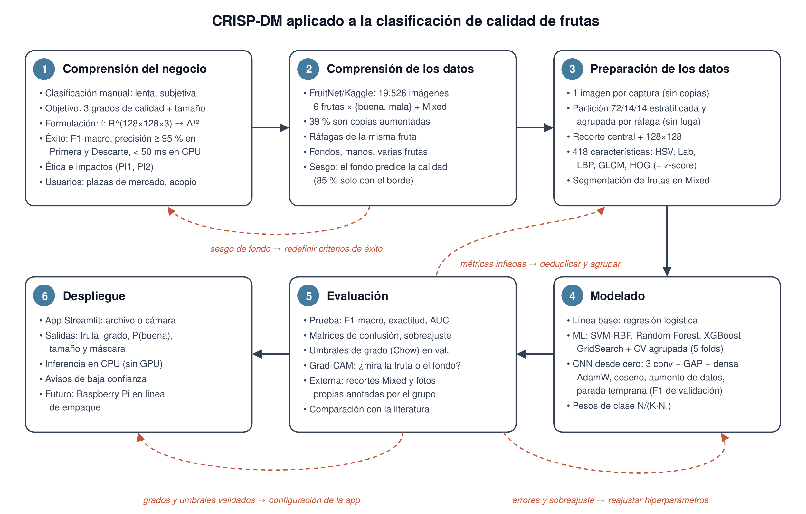
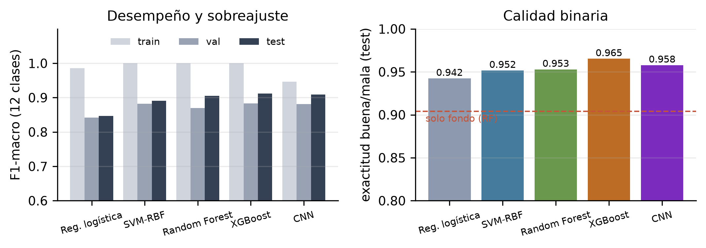
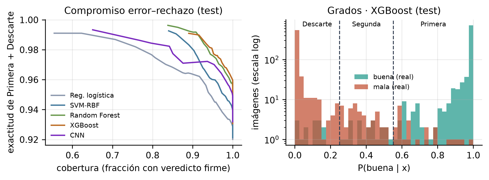
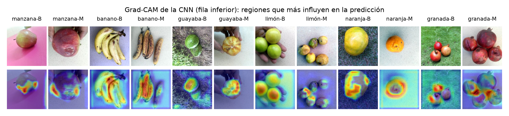
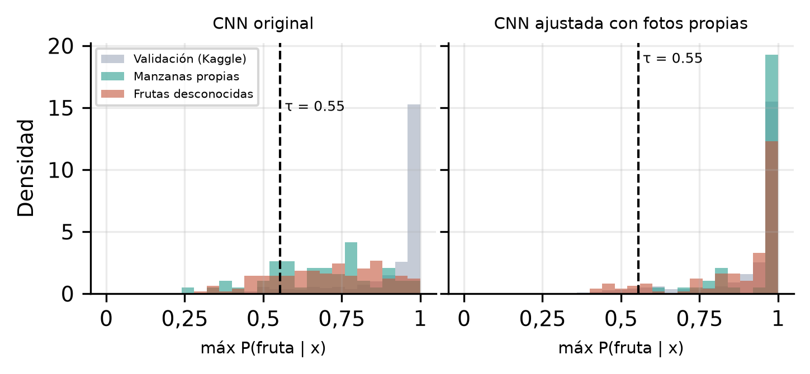
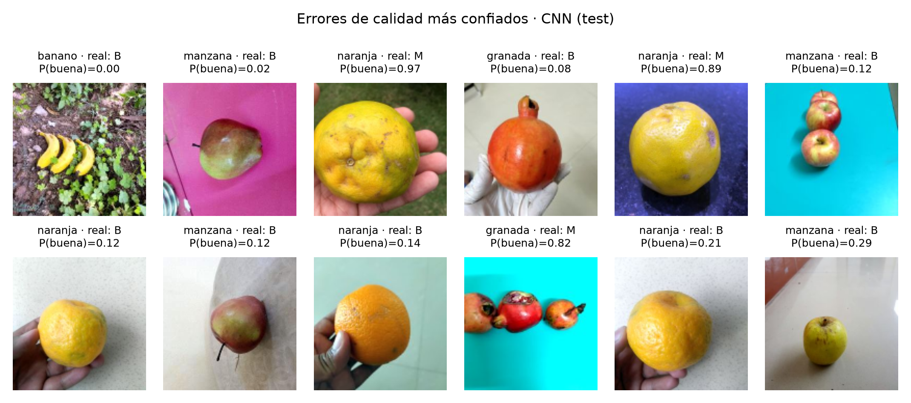

# Clasificación automática de la calidad de frutas con visión por computador

Resumen— La clasificación manual de frutas por calidad es lenta, subjetiva y contribuye a la pérdida de alimentos. Este trabajo desarrolla, con la metodología CRISP-DM, un sistema que a partir de la fotografía de una fruta reconoce la especie, asigna un grado comercial (Primera, Segunda o Descarte) y estima su tamaño relativo. Sobre el conjunto FruitNet (seis frutas, calidad buena o mala) se eliminaron las copias aumentadas y se particionó por ráfagas de captura para evitar fuga de información. Se compararon cuatro modelos clásicos sobre 418 características de color, textura y forma con una red convolucional de 113 mil parámetros entrenada desde cero. XGBoost y la red obtienen un F1-macro de 0,91 en las 12 clases fruta por calidad, sin diferencia significativa entre ellos, y una regla de rechazo garantiza más del 95 % de precisión en los grados Primera y Descarte. La red sobreajusta menos, responde en 6 ms en CPU y, según Grad-CAM, atiende sobre todo a la fruta. Sin embargo, un modelo que solo ve el fondo de la foto acierta la calidad en el 90 % de los casos, y en fotografías de sesiones nuevas la exactitud de fruta cae al 59 %: el principal reto es la generalización. Un ajuste fino con fotos propias eleva el acierto de grado en ellas del 38 % al 92 %, pero también hace pasar frutas desconocidas por manzana. El sistema se despliega en una aplicación web con cámara y un modo en tiempo real.

Palabras clave— visión por computador, calidad de frutas, redes neuronales convolucionales, aprendizaje automático, CRISP-DM

## Introducción

En las plazas de mercado, centros de acopio y empacadoras, las frutas se clasifican a mano según su color, sus manchas, golpes y podredumbre, y su tamaño. El proceso es lento, depende del criterio y del cansancio de cada persona y no sigue un estándar, de modo que el precio se negocia caso por caso. En Colombia se pierden o desperdician cerca de 9,76 millones de toneladas de alimentos al año, el 34 % de la oferta disponible [1], y en el mundo alrededor del 14 % se pierde entre la cosecha y la venta minorista [2]. Una clasificación temprana y consistente permite destinar cada fruta a su mejor uso (venta en fresco, procesamiento o compostaje) en lugar de descartar lotes completos.

El objetivo es un sistema que, a partir de la foto de **una** fruta sobre un fondo simple, entregue (i) la fruta, (ii) un grado de calidad de tres categorías y (iii) un tamaño relativo, con un celular o una webcam y un computador sin GPU. Los tres grados se inspiran en las normas del Codex Alimentarius, que también definen tres categorías comerciales [3]. Los criterios de éxito se fijaron antes de modelar: F1-macro ≥ 0,85 en las 12 clases fruta × calidad, precisión ≥ 95 % en Primera y en Descarte, menos de 50 ms por imagen en CPU y reporte de la brecha con datos externos.

El problema es complejo: cada imagen tiene decenas de miles de variables frente a unas 8.000 imágenes de entrenamiento; una mancha pequeña separa una fruta buena de una mala, mientras dos frutas buenas pueden verse muy distintas; el conjunto de datos contiene copias y ráfagas casi idénticas que rompen el supuesto de independencia; los errores tienen costos asimétricos (vender una fruta podrida no cuesta lo mismo que botar una sana); y, como se mostrará, el fondo de la foto está correlacionado con la etiqueta. Las contribuciones son un protocolo de partición sin fuga, una comparación estadística entre cuatro modelos clásicos y una CNN, una regla de grados con garantía de precisión, la cuantificación del sesgo de fondo y una aplicación desplegable. El código documentado, los notebooks, las fotos propias y los resultados están en el repositorio del proyecto [22], y el video de presentación en [23].

## Fundamentos teóricos

### Formulación

Sea x̃ la imagen preprocesada. Cada modelo estima la distribución conjunta sobre las K = 12 clases y = (f, q), con f una de seis frutas y q ∈ {buena, mala}, y se entrena minimizando la entropía cruzada ponderada con regularización:

$$
L(\theta) = -\frac{1}{N} \sum_{i=1}^{N} w_{y_i} \log P_\theta(y_i \mid \tilde{x}_i) + \lambda \lVert \theta \rVert_2^2 \tag{1}
$$

donde $w_k = N/(K N_k)$ compensa el desbalance de clases. La probabilidad de calidad y la fruta se obtienen por marginalización:

$$
\begin{aligned} p(\tilde{x}) &= \sum_{f} P(f, \text{buena} \mid \tilde{x}) \\ \hat{f} &= \arg\max_{f} \sum_{q} P(f, q \mid \tilde{x}) \end{aligned} \tag{2}
$$

Un modelo conjunto aprovecha que lo que significa «mala» depende de la fruta.

### Grados con opción de rechazo

Como el conjunto de datos solo tiene dos etiquetas de calidad, el tercer grado se deriva con la regla de rechazo de Chow [4]: Primera si $p \ge \tau_{\text{alto}}$, Descarte si $p \le \tau_{\text{bajo}}$ y Segunda en otro caso. Los umbrales se eligen en validación:

$$
\begin{aligned} \tau_{\text{alto}} &= \min \{ \tau : P(\text{buena} \mid p \ge \tau) \ge \pi \} \\ \tau_{\text{bajo}} &= \max \{ \tau : P(\text{mala} \mid p \le \tau) \ge \pi \} \end{aligned} \tag{3}
$$

La Segunda recoge los casos dudosos, que se revisan a mano o se venden a menor precio. Subir π aumenta la confiabilidad a costa de la *cobertura*, la fracción de frutas con veredicto firme. Se usó π = 98 % en validación, tres puntos por encima del criterio de éxito, porque la precisión medida justo en el umbral baja al pasar a datos nuevos.

### Modelos

La **regresión logística** multinomial es la línea base lineal. La **SVM con kernel RBF** [5] busca la frontera de margen máximo en el espacio inducido por $K(x, x') = \exp(-\gamma \lVert x - x' \rVert^2)$. **Random Forest** [6] promedia árboles entrenados con muestras *bootstrap* y subconjuntos aleatorios de características, lo que reduce la varianza. **XGBoost** [7] construye un modelo aditivo en el que cada árbol corrige el gradiente de la pérdida de los anteriores, con penalización sobre el número y el peso de las hojas. Una **red convolucional** (CNN) aprende de los píxeles filtros que comparten pesos sobre toda la imagen, de modo que un defecto se detecta igual en cualquier posición.

## Metodología

El proyecto siguió las seis fases de CRISP-DM [8], con varias iteraciones entre ellas (Fig. 1).

### Datos

Se usó *Fruit Quality Classification* (Kaggle, CC0) [9], derivado de FruitNet [10]: 19.526 imágenes de manzana, banano, guayaba, limón, naranja y granada, en calidad buena o mala, más una carpeta *Mixed* con varias frutas por foto. El análisis exploratorio reveló tres problemas que el artículo original no documenta. Primero, el 39 % de los archivos son **copias aumentadas** de la misma captura (el 81 % en granada buena). Segundo, las fotos se tomaron en **ráfagas**: segundos de diferencia, mismo fondo y misma luz. Tercero, las frutas buenas y malas se fotografiaron en buena parte sobre fondos distintos.

{ancho=6.4}

### Preparación

Se conservó una imagen por captura (12.185 únicas) y se agruparon las ráfagas en ventanas de 60 s. Con `StratifiedGroupKFold` se separó ≈ 14 % para prueba y ≈ 14 % para validación sin que ninguna ráfaga quede en dos conjuntos (8.078 / 1.620 / 1.614 imágenes; se verificaron cero grupos y cero hashes compartidos). Al quitar las copias, el desbalance máximo entre clases bajó de 5,5:1 a 1,5:1. Cada imagen se recortó al cuadrado central y se redujo a 128×128. Para los modelos clásicos se extrajeron 418 características: histogramas y momentos de color en HSV y CIELab, proporción de píxeles oscuros y marrones, textura LBP [11] y GLCM [12], y forma HOG [13], estandarizadas con la media y la varianza de entrenamiento. Las 873 fotos *Mixed* se segmentaron en 3.640 recortes individuales (fondo por k-means en Lab, umbral de Otsu [14], *watershed* para separar frutas que se tocan y filtros de forma).

### Tamaño

La fruta se segmenta por distancia de color al fondo (mediana del borde en CIELab), umbral de Otsu y morfología. Con el área A de la máscara se calcula el diámetro equivalente normalizado

$$
d_{\text{norm}} = \frac{2\sqrt{A/\pi}}{\min(H, W)} \in (0, 1] \tag{4}
$$

que se discretiza en pequeño, mediano o grande con umbrales por fruta. Es una medida **relativa**: depende de la distancia de la cámara, que el protocolo de captura fija en unos 30 cm.

### Modelado y ajuste

Los modelos clásicos se ajustaron con `GridSearchCV` y validación cruzada agrupada de 5 pliegues sobre train, maximizando el F1-macro. La CNN tiene tres bloques convolucionales (5×5 con 32 filtros, 3×3 con 64 y 3×3 con 128, cada uno con *BatchNorm*, ReLU y *max-pooling*), *global average pooling*, una capa densa de 128 con *dropout* y 12 salidas: 113.068 parámetros. Se entrenó en CPU con entradas de 96×96, AdamW [15] con decaimiento coseno de la tasa de aprendizaje, aumento de datos (recortes, volteos, rotaciones y brillo, sin alterar el tono, que es la señal de calidad) y parada temprana por F1 de validación. Una rejilla de 2×2 en validación eligió η₀ = 10⁻³ y *dropout* 0,3; el modelo final se entrenó 35 épocas (40 min). El conjunto de prueba se usó una sola vez.

## Resultados

### Clasificación

La Tabla I y la Fig. 2 resumen el desempeño. Los intervalos de confianza del 95 % se obtuvieron por *bootstrap* (1.000 remuestreos del conjunto de prueba). Las dos últimas filas son un **control**: los mismos modelos entrenados solo con el color de un anillo de 16 px del borde de la imagen, donde casi siempre hay fondo y no fruta.

Tabla: F1-macro (12 clases) y exactitud de calidad

| Modelo | F1 train | F1 val | F1 test [IC 95 %] | Calidad test |
|---|---|---|---|---|
| Reg. logística | 0,986 | 0,842 | 0,847 [0,828; 0,862] | 0,942 |
| SVM-RBF | 1,000 | 0,882 | 0,891 [0,876; 0,905] | 0,952 |
| Random Forest | 1,000 | 0,869 | 0,905 [0,890; 0,919] | 0,953 |
| XGBoost | 1,000 | **0,883** | **0,912** [0,898; 0,925] | **0,965** |
| CNN | **0,947** | 0,881 | 0,909 [0,895; 0,922] | 0,958 |
| RF, solo fondo | 1,000 | 0,712 | 0,778 [0,759; 0,796] | 0,904 |
| Reg. log., solo fondo | 0,710 | 0,570 | 0,615 [0,591; 0,636] | 0,833 |

{ancho=3.4}

La prueba de McNemar [16] entre la CNN y XGBoost sobre las mismas 1.614 imágenes no encuentra diferencia: en calidad, solo la CNN acierta en 34 casos y solo XGBoost en 46 (p = 0,22); en la tarea conjunta, 73 frente a 80 (p = 0,63). La exactitud de fruta en prueba es 0,936 para XGBoost y 0,932 para la CNN.

### Grados y criterios de éxito

Con π = 98 % en validación, los cinco modelos superan el 95 % de precisión en Primera y en Descarte en prueba (Tabla II); la Fig. 3 muestra cuánto cuesta, en cobertura, exigir más precisión. La latencia de punta a punta en la aplicación (recorte, modelo, grado y tamaño) es de 6,2 ms con la CNN y 36,6 ms con XGBoost, de los cuales 33,5 ms son la extracción de características.

Tabla: Grados en prueba (umbrales fijados en validación)

| Modelo | Cobertura | Prec. Primera | Prec. Descarte | Segunda |
|---|---|---|---|---|
| Reg. logística | 84,5 % | 96,1 % | 98,4 % | 15,5 % |
| SVM-RBF | 91,3 % | 97,5 % | 97,7 % | 8,7 % |
| Random Forest | 92,6 % | 98,9 % | 97,9 % | 7,4 % |
| XGBoost | **95,9 %** | 97,4 % | 97,9 % | 4,1 % |
| CNN | 94,1 % | 95,8 % | **99,5 %** | 5,9 % |

{ancho=3.4}

### Atención de la CNN y datos externos

Con Grad-CAM [17] se midió qué fracción de la activación cae en el anillo del borde, que ocupa el 43,8 % del área: en promedio es el 25,9 %, y solo el 5,1 % de las imágenes pone en el borde más energía que su área (Fig. 4). En las 873 fotos de *Mixed*, que vienen de sesiones distintas, la exactitud de fruta baja al 59,2 % con la CNN y al 48,2 % con XGBoost; en los 3.640 recortes individuales, la CNN obtiene 42,1 %.

Con las **48 fotos propias** de manzana (casa, otros fondos y luz) la CNN acierta la fruta en el 83 %, pero el grado solo coincide en el 38 % y el tamaño en el 33 %. La probabilidad media de «buena» cae a 0,28 y el 54 % de las manzanas sanas se envía a Segunda: el modelo reconoce la fruta, pero su calibración no se traslada. El tamaño falla porque los umbrales absolutos del dataset no corresponden a la distancia de captura; recalibrarlos con estas fotos da (0,60, 0,65) para manzana. El set no incluye Descarte, de modo que esa clase no se evalúa.

**Ajuste fino y fruta desconocida.** Se reentrenó la CNN 4 épocas desde sus pesos con Kaggle más las manzanas propias, con validación cruzada de 4 pliegues sobre ellas. En fotos no vistas, la fruta sube al 100 % y el grado al 92 %, mientras el F1 de prueba apenas cambia (0,908). Para comprobar si era una mejora real se usaron 122 fotos propias de frutas fuera del catálogo (fresa, lulo, tomate y tomate de árbol). Un umbral de confianza fijado en validación (τ = 0,55) rechaza solo el 21 % de ellas con la CNN original, y el mismo 21 % de las manzanas propias. Tras el ajuste, el 83 % de esas frutas pasa por manzana y el rechazo cae al 9 % (Fig. 5): la red aprendió en parte el contexto de la casa. Por eso se mantiene la CNN original.

## Análisis de resultados

**¿Qué funciona?** Dentro del dominio del conjunto de datos se cumplen todos los criterios de éxito. XGBoost y la CNN quedan empatados (los intervalos se solapan y McNemar no es significativo), y ambos superan con claridad a la línea base: la combinación no lineal de color y textura aporta 4–6 puntos de F1. La regla de rechazo funciona como se diseñó: la Segunda concentra los casos difíciles (solo el 23–51 % de sus frutas son buenas), y revisar a mano el 4 % de las frutas basta para que XGBoost alcance 97–98 % de precisión en sus veredictos. Los modelos son complementarios: la CNN es la mejor en guayaba, limón y manzana, y XGBoost en naranja, donde la CNN confunde el 16 % de las naranjas buenas con malas.

{ancho=6.4}

**Sobreajuste.** Los modelos clásicos memorizan el entrenamiento (F1 = 1,0) y pierden 9–14 puntos en prueba. La CNN pierde solo 3,7: el aumento de datos, el *dropout*, el *global average pooling* y su tamaño reducido actúan como regularizadores, y su curva de validación sigue a la de entrenamiento durante las 35 épocas. Su mejor época fue la 34: aún no había convergido. En todos los modelos el F1 de prueba supera al de validación en 2–3 puntos; no es fuga (se verificó), sino que con particiones agrupadas cada conjunto recibe sesiones completas y el de prueba resultó algo más fácil. Por eso la selección se hizo con validación.

**¿Qué falla? El sesgo de fondo.** El control de la Tabla I es el hallazgo central: **mirando solo el borde**, un Random Forest acierta la calidad en el 90,4 % de las imágenes de prueba. La imagen completa aporta 5–6 puntos sobre ese piso. Grad-CAM muestra que la CNN se apoya sobre todo en la fruta (pone en el borde un 40 % menos de atención que al azar), pero sus errores más confiados son frutas buenas sostenidas en la mano o con guantes, que clasifica como malas (Fig. 6): el contexto de la sesión sigue influyendo. La consecuencia aparece en *Mixed*: con sesiones nuevas, todos los modelos pierden entre 34 y 49 puntos de exactitud de fruta, con confusiones sistemáticas (limones maduros → naranja, granadas → manzana). La CNN generaliza mejor que los modelos clásicos (59 % frente a 43–48 %), porque las características de color diseñadas a mano son más sensibles al fondo y a la luz que los filtros aprendidos con aumento de datos.

{ancho=3.4}

{ancho=3.4}

**Comparación con la literatura.** El artículo de FruitNet [10] no reporta modelos. Morshed et al. [18] obtienen 99,67 % de exactitud con DenseNet201 preentrenada sobre las 19.526 imágenes, y su resumen no describe cómo se separaron las copias. Nuestras cifras son menores, pero el protocolo es más estricto: con 39 % de copias y fotos en ráfaga, una partición aleatoria pone casi la misma imagen en entrenamiento y en prueba. La caída en *Mixed* indica que incluso nuestras cifras sobrestiman el desempeño en condiciones reales, y que las exactitudes cercanas al 100 % en este conjunto deben leerse con cautela.

**Selección.** Para la aplicación se eligió la CNN: empata con XGBoost, sobreajusta menos, generaliza mejor, mira la fruta, es seis veces más rápida y su Descarte casi nunca bota una fruta buena (99,5 %).

## Ética e impactos

El análisis se basó en el Código de Ética de la ACM [19], el del IEEE [20] y la Ley 842 de 2003, que regula el ejercicio de la ingeniería en Colombia [21]. La Tabla III resume los dilemas principales y la Tabla IV la matriz de impactos; el análisis completo está en el repositorio.

Tabla: Dilemas éticos y medidas adoptadas

| Situación | Principio | Medida |
|---|---|---|
| Fotos propias: rostros, hogares, ubicación | Privacidad (ACM 1.6; Ley 1581 de 2012) | Sin personas; fotos con varias frutas, marcas o manos se excluyen; se borran GPS y fecha (EXIF) |
| Sesgo de fondo; frutas de otro país | Justicia y evaluación de riesgos (ACM 1.4, 2.5) | Sesgo medido y reportado; Grad-CAM; evaluación externa |
| Métricas infladas por copias | Honestidad (ACM 1.3; IEEE I.5) | Deduplicación, partición agrupada, prueba usada una vez |
| Fruta podrida vendida como Primera | Seguridad del consumidor (ACM 1.2; IEEE I.1) | Umbral con precisión ≥ 95 %; dudosas a Segunda |
| Fruta buena descartada | Bienestar del productor (ACM 1.1) | Umbral de Descarte con precisión ≥ 95 % |
| Automatizar un trabajo manual | Impacto social (ACM 3.7) | Herramienta de apoyo: una persona revisa la Segunda |

Tabla: Matriz de impactos

| Dimensión | Impacto positivo | Riesgo y mitigación |
|---|---|---|
| Social | Clasificación consistente y transparente para vendedor y comprador | Desconfianza si falla: humano en el ciclo y avisos de baja confianza |
| Económica | Precio por grado; la Segunda se vende o procesa en vez de botarse; sin GPU | Errores con costo: precisión garantizada; apoyo, no certificación |
| Ambiental | Menos desperdicio de alimentos; modelo de 113 mil parámetros en CPU | Energía y hardware: se reutilizan celulares y portátiles |
| Global | Replicable en otros mercados con poco costo | Variedades y condiciones distintas: recalibrar con datos locales |

## Conclusiones y trabajo futuro

Se construyó, siguiendo CRISP-DM, un sistema completo que reconoce la fruta, asigna un grado comercial con garantía de precisión y estima el tamaño relativo, desplegado en una aplicación web con cámara y en un modo de tiempo real que simula una línea de empaque. Dentro del dominio del conjunto de datos se cumplen todos los criterios de éxito: F1-macro de 0,91, precisión de 95,8–99,5 % en Primera y Descarte y 6 ms por imagen en CPU.

La lección principal es metodológica. Las copias aumentadas, las ráfagas y el fondo hacen que una evaluación ingenua sobreestime el desempeño, y solo una partición agrupada, un experimento de control y la evaluación en datos externos revelan la capacidad real del modelo. Una red pequeña entrenada desde cero iguala al mejor modelo clásico, sobreajusta menos y generaliza mejor, aunque ambos dependen todavía del contexto de captura.

Las fotos propias muestran que reentrenar con datos locales funciona (el grado en fotos nuevas pasa del 38 % al 92 %), pero si esos datos tienen una sola fruta, un solo grado y un solo lugar, el modelo aprende el lugar. Como trabajo futuro se proponen: (i) ampliar las fotos locales a las seis frutas, los tres grados y varios fondos, y añadir una clase «otra fruta» para rechazar especies fuera del catálogo; (ii) segmentar la fruta o aleatorizar el fondo durante el aumento de datos para cortar el atajo del fondo; (iii) un ensamble de la CNN y XGBoost, que se equivocan en imágenes distintas; (iv) transferencia de aprendizaje con capas congeladas; (v) calibrar el tamaño con un objeto de referencia para medirlo en centímetros; y (vi) llevar el modo de tiempo real a una Raspberry Pi sobre una banda transportadora, con aprendizaje activo sobre las frutas que caen en Segunda.

## Referencias

[1] Departamento Nacional de Planeación, “Pérdida y desperdicio de alimentos en Colombia: estudio de la Dirección de Seguimiento y Evaluación de Políticas Públicas,” DNP, Bogotá, Colombia, 2016.
[2] FAO, *The State of Food and Agriculture 2019: Moving Forward on Food Loss and Waste Reduction*. Rome, Italy: FAO, 2019.
[3] Codex Alimentarius Commission, “Standard for apples,” CXS 299-2010, FAO/WHO, 2010.
[4] C. K. Chow, “On optimum recognition error and reject tradeoff,” *IEEE Trans. Inf. Theory*, vol. 16, no. 1, pp. 41–46, 1970.
[5] C. Cortes and V. Vapnik, “Support-vector networks,” *Mach. Learn.*, vol. 20, no. 3, pp. 273–297, 1995.
[6] L. Breiman, “Random forests,” *Mach. Learn.*, vol. 45, no. 1, pp. 5–32, 2001.
[7] T. Chen and C. Guestrin, “XGBoost: A scalable tree boosting system,” in *Proc. 22nd ACM SIGKDD Int. Conf. Knowl. Discov. Data Min.*, 2016, pp. 785–794.
[8] R. Wirth and J. Hipp, “CRISP-DM: Towards a standard process model for data mining,” in *Proc. 4th Int. Conf. Practical Appl. Knowl. Discov. Data Min.*, 2000, pp. 29–39.
[9] R. Park, “Fruit quality classification,” Kaggle, 2022. [Online]. Available: https://www.kaggle.com/datasets/ryandpark/fruit-quality-classification
[10] V. Meshram and K. Patil, “FruitNet: Indian fruits image dataset with quality for machine learning applications,” *Data in Brief*, vol. 40, art. 107686, 2022, doi: 10.1016/j.dib.2021.107686.
[11] T. Ojala, M. Pietikäinen, and T. Mäenpää, “Multiresolution gray-scale and rotation invariant texture classification with local binary patterns,” *IEEE Trans. Pattern Anal. Mach. Intell.*, vol. 24, no. 7, pp. 971–987, 2002.
[12] R. M. Haralick, K. Shanmugam, and I. Dinstein, “Textural features for image classification,” *IEEE Trans. Syst., Man, Cybern.*, vol. SMC-3, no. 6, pp. 610–621, 1973.
[13] N. Dalal and B. Triggs, “Histograms of oriented gradients for human detection,” in *Proc. IEEE CVPR*, 2005, pp. 886–893.
[14] N. Otsu, “A threshold selection method from gray-level histograms,” *IEEE Trans. Syst., Man, Cybern.*, vol. 9, no. 1, pp. 62–66, 1979.
[15] I. Loshchilov and F. Hutter, “Decoupled weight decay regularization,” in *Proc. ICLR*, 2019.
[16] T. G. Dietterich, “Approximate statistical tests for comparing supervised classification learning algorithms,” *Neural Comput.*, vol. 10, no. 7, pp. 1895–1923, 1998.
[17] R. R. Selvaraju, M. Cogswell, A. Das, R. Vedantam, D. Parikh, and D. Batra, “Grad-CAM: Visual explanations from deep networks via gradient-based localization,” in *Proc. IEEE ICCV*, 2017, pp. 618–626.
[18] M. S. Morshed, S. Ahmed, T. Ahmed, M. U. Islam, and A. B. M. A. Rahman, “Fruit quality assessment with densely connected convolutional neural network,” in *Proc. 12th Int. Conf. Electr. Comput. Eng. (ICECE)*, 2022, arXiv:2212.04255.
[19] Association for Computing Machinery, “ACM code of ethics and professional conduct,” 2018. [Online]. Available: https://www.acm.org/code-of-ethics
[20] IEEE, “IEEE code of ethics,” 2020. [Online]. Available: https://www.ieee.org/about/corporate/governance/p7-8.html
[21] Congreso de Colombia, “Ley 842 de 2003, por la cual se modifica la reglamentación del ejercicio de la ingeniería,” *Diario Oficial*, no. 45.340, 2003.
[22] M. Pérez, D. Zambrano, M. Berrío, and S. Romero, “ProyectoFinalApo3: clasificación automática de la calidad de frutas,” GitHub, 2026. [Online]. Available: https://github.com/miguelperezdev/ProyectoFinalApo3
[23] M. Pérez, D. Zambrano, M. Berrío, and S. Romero, “Clasificación automática de la calidad de frutas: video de presentación,” 2026. [Online]. Available: https://canva.link/gkvnycpm3mnc2wd
